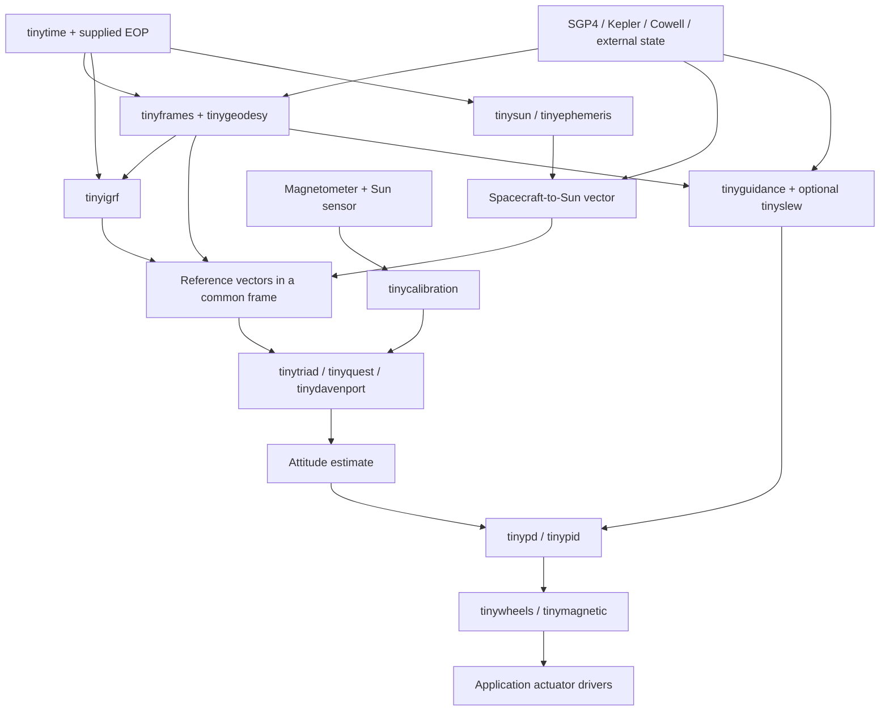

# TinyNadir

TinyNadir is a collection of algorithms for CubeSats and other embedded spacecraft systems. It brings established algorithms, such as Vallado's SGP4, into small C libraries with caller-owned storage and no heap allocation.

The collection is intended to grow to cover orbit propagation, attitude determination, and control. **The current implementation is the `tinysgp4` orbit propagation module.** Attitude estimators and controllers have not been implemented yet.

## Modules

| Module | Function | Status |
| --- | --- | --- |
| [tinysgp4](tinysgp4/README.md) | Double-precision SGP4, including near-Earth and deep-space propagation, from traditional TLEs | Implemented in C99; checked against frozen Vallado reference outputs |

Modules live in their own subdirectories with their source, headers, examples, tests, and attribution. They can be built independently or selected through the collection's CMake project. Test fixtures and examples are separate from the libraries used in firmware.

The design goals are explicit memory ownership, no hidden allocation, and documented numerical behavior and resource use. Memory and execution-time budgets depend on the chosen module, compiler, and platform. See each module's README for its supported inputs, validation coverage, and measured sizes.

## Algorithm roadmap

This is the proposed capability inventory for the collection. **Only `tinysgp4` exists today; every other name below is planned, including TRIAD, QUEST, and IGRF.** Names follow `tiny<algorithm>` or, for tightly related helpers, `tiny<family>`. Table entries do not create libraries, APIs, or CMake options yet.

The Vallado inventory is pinned to [CelesTrak/fundamentals-of-astrodynamics, commit `49df0479c950917c0a2c5ac31f2db6477bba57f6`](https://github.com/CelesTrak/fundamentals-of-astrodynamics/tree/49df0479c950917c0a2c5ac31f2db6477bba57f6). It covers the mathematical capabilities in AstroLib, MathTimeLib, EopSpw, astPert, SGP4/SGP4DC, the atmosphere libraries, and the additional MATLAB/Python routines. Language duplicates and private helper functions are grouped under their owning algorithm rather than becoming separate libraries. The attitude estimation and control sections extend that inventory for CubeSat ADCS; they are not all Vallado source ports.

The intended layers are [foundations](#foundations), [orbit propagation](#orbit-propagation), [environment models](#environment-models), [attitude estimation](#attitude-estimation), [guidance and control](#guidance-and-control), and [navigation and mission analysis](#navigation-and-mission-analysis). See [composition rules](#composition-rules) and [example assemblies](#example-assemblies) for how to combine them.

### Foundations

These pieces support several algorithms and should not pull in a complete orbit or attitude stack. Most correspond to Vallado's MathTimeLib, time/frame routines, and state conversions.

| Proposed module | Algorithm and purpose | Inputs → outputs | Connections and overlap |
| --- | --- | --- | --- |
| `tinylinalg` | Bounded vector/matrix operations, linear solves, LU/Cholesky factorization, and small symmetric eigensystems. | Fixed-size arrays and caller workspace → vectors, factors, or solutions. | Shared building blocks for estimators, covariance, Lambert, and actuator allocation; no general heap-based matrix container. |
| `tinyrotation` | Quaternion, direction-cosine matrix (DCM), Euler-angle, and axis-angle operations; composition and interpolation. | An explicitly defined rotation representation → another representation or rotated vectors. | Shared by TRIAD, QUEST, gyro propagation, guidance, and controllers. Conversion is not attitude determination. |
| `tinytime` | Calendar, day-of-year, split Julian date, elapsed time, and UTC/TAI/TT/UT1/TDB conversions. | Epoch and required leap-second/Earth-orientation inputs → explicitly labeled time scales. | Supplies frames, ephemerides, IGRF decimal year, and propagation time differences. No implicit onboard clock access. |
| `tinyeop` | Bounded interpolation of Earth-orientation parameters and optional precomputed IAU X/Y/s tables. | Epoch and caller-supplied table window → UT1−UTC, polar motion, celestial corrections, or X/Y/s. | Data provider for `tinyframes`; approximate modes must identify omitted corrections. File downloads and archive loading stay outside the kernels. |
| `tinyframes` | TEME, GCRF/J2000, ITRF/ECEF, and intermediate frame transformations; sidereal time, precession, nutation, Earth rotation, and polar motion. | Labeled epoch, time/EOP inputs, and state/vector → state/vector in another frame. | Bridges SGP4 to geodesy, IGRF, and attitude reference vectors. IAU-1980/legacy and IAU-2000/2006 paths are explicit model choices; FK4/FK5 compatibility is a later profile. |
| `tinygeodesy` | Ellipsoidal latitude/longitude/height, geocentric latitude, ground-site coordinates, and local ENU/NED/SEZ frames. | ECEF position or geodetic coordinates plus ellipsoid → converted position/local basis. | Used by field models, ground tracking, and coverage. Geodetic latitude and height are distinct from geocentric latitude and radius. |
| `tinyelements` | Cartesian state ↔ classical/equinoctial orbital elements; flight-path coordinates; RSW/RTN, NTW, and perifocal bases. | Position/velocity and gravitational parameter → orbital representation and local frames. | Connects propagation, relative motion, maneuvers, and navigation. Degenerate circular/equatorial cases need explicit conventions. |
| `tinyanomaly` | Bounded Kepler-equation solvers and conversions among mean, eccentric/hyperbolic, and true anomaly. | Eccentricity and anomaly → converted anomaly and convergence status. | Mathematical helper for `tinykepler`, element conversions, and transfer calculations; not a complete propagator on its own. |
| `tinystumpff` | Stable Stumpff functions and universal-variable support across conic types. | Universal-variable argument → function values and, where needed, derivatives. | Shared numerical primitive for universal Kepler and Lambert solvers. |
| `tinyinterpolation` | Linear, cubic, and bounded table interpolation. | Explicit sample window and query → value/derivatives. | Shared by EOP, space weather, and ephemeris tables. Interpolation and out-of-range policy belong to each caller. |
| `tinypolynomial` | Bounded real/complex polynomial root solvers needed by Vallado geometry routines. | Coefficients and selected order → roots and solve status. | Supports angles-only orbit determination and eclipse event geometry. Only required orders/features should be linked. |
| `tinyelliptic` | Elliptic integrals, inverse elliptic-integral calculations, and ellipse arc-length utilities. | Ellipse parameters and angles/arc length → integrals or inverse geometry. | Optional support for orbital-arc and mission-geometry calculations; distinct from Kepler-equation solving. |

### Orbit propagation

These algorithms overlap in output, but their initial conditions and physical assumptions differ. **Kepler propagation is an alternative orbit model, not a drop-in replacement for SGP4 on a TLE.** TLE elements are fitted for SGP4; their mean elements cannot simply be passed to another theory as ordinary osculating elements. See [CelesTrak's explanation](https://celestrak.org/columns/v04n05/).

| Module | Algorithm and purpose | Inputs → outputs | Connections and overlap |
| --- | --- | --- | --- |
| [tinysgp4](tinysgp4/README.md) — implemented | Vallado-compatible SGP4 with its deep-space branch. | Supported traditional TLE plus minutes from epoch → TEME position/velocity in km and km/s. | Primary path for conventional public GP elements. Already includes SDP4 behavior; no separate deep-space library is needed. |
| `tinykepler` | Universal-variable two-body propagation with Lagrange f/g coefficients. | Osculating Cartesian state, gravitational parameter, elapsed seconds → propagated state. | Lightweight idealized propagation and coast segments. Omits drag, Earth oblateness, and third bodies. |
| `tinypkepler` | Vallado's approximate perturbed-Kepler models, including J2 and J4 variants and the selected secular terms. | Model-specific mean elements and parameters → approximate propagated state. | Alternative to two-body propagation for secular-trend studies; not interchangeable with SGP4 mean elements. |
| `tinyrk4` | Fixed-step fourth-order Runge–Kutta integration. | State, derivative callback, step size, bounded workspace → advanced state. | General integrator for `tinycowell` or `tinyrigidbody`; the derivative model determines the physics. |
| `tinyrkf45` | Adaptive Runge–Kutta–Fehlberg 4/5 integration with explicit error and work limits. | State, derivative callback, tolerances, step/work bounds → state and integration status. | Alternative to `tinyrk4`; variable cost must be bounded for flight scheduling. |
| `tinycowell` | Cartesian numerical orbit propagation using selected acceleration models. | Initial state, epoch, forces, spacecraft parameters, integrator → propagated state. | Composes with gravity, drag, third-body, and SRP modules. Higher fidelity needs suitable initial states and force data, not just more arithmetic on a TLE. |
| `tinymeanosculating` | Vallado's iterative mean↔osculating conversions for the supported zonal, third-body, and SRP theories. | State and a named perturbation theory/model → corresponding mean or osculating state. | Supports `tinypkepler` and perturbation studies. Not a universal TLE conversion routine. |
| `tinysecular` | Vallado's separate zonal, drag, third-body, and SRP periodic/secular perturbation calculations. | Compatible mean state, environment parameters, elapsed time → element changes/reconstructed state. | Optional analytical/semianalytical alternatives to numerical force integration; avoid applying the same perturbation twice. |
| `tinysgp4xp` — deferred | SGP4-XP for XP-derived element sets. | XP elements and the required model inputs → propagated state. | Separate future investigation; no implementation or source/license route has been selected. Conventional SGP4 remains necessary. |

Input formats are separate from propagation theory:

| Proposed module | Algorithm and purpose | Inputs → outputs | Connections and overlap |
| --- | --- | --- | --- |
| `tinytle` | Bounded traditional/Alpha-5 TLE parsing, checksums, catalog identifiers, and ephemeris-type validation. | Two element lines → validated GP elements/epoch. | Future extraction/extension of the parser currently inside `tinysgp4`. Alpha-5 changes identifiers, not the propagation model. A TLE writer is optional later work. |
| `tinyomm` | A documented SGP4-compatible OMM input subset, starting with KVN or a bounded field adapter; optional JSON/CSV adapters. | Decoded OMM fields or supported text → validated GP elements/epoch and metadata. | Another route into SGP4 initialization from elements, without round-tripping through TLE text. Check reference frame, time system, center, and mean-element theory. Full XML support is not required for the first embedded profile. |

### Environment models

These modules predict reference vectors or forces. They take position and time as inputs, so an application can use SGP4, Kepler, a numerical propagator, GNSS, or an uploaded state as its position source. **IGRF is a magnetic-field model, not an orbit propagator or an attitude estimator.**

| Proposed module | Algorithm and purpose | Inputs → outputs | Connections and overlap |
| --- | --- | --- | --- |
| `tinysun` | Vallado's analytical Sun position and direction. | Required astronomical time scale → labeled Earth-to-Sun position/direction. | Subtract spacecraft position for a spacecraft-to-Sun reference vector; feeds attitude estimation, Sun pointing, SRP, and eclipse geometry. |
| `tinymoon` | Vallado's analytical Moon position and direction. | Required astronomical time scale → labeled Earth-to-Moon state/position. | Supplies third-body gravity and lunar geometry; usually optional for basic CubeSat ADCS. |
| `tinyephemeris` | Bounded interpolation of supplied Sun/Moon ephemeris samples. | Epoch and a mission-sized read-only table window → celestial position/state. | Alternative provider to `tinysun`/`tinymoon`; full JPL archive handling stays on the host. Accuracy depends on table source, spacing, and interpolation. |
| `tinyigrf` | IAGA International Geomagnetic Reference Field synthesis; initial target IGRF-14. | Valid epoch, position, selected coefficient set/degree → magnetic field in explicitly labeled components. | Magnetic reference for TRIAD/QUEST/MEKF and simulation of magnetorquers. Convert components into the estimator's reference frame before use. Epoch coverage and any degree truncation are explicit. |
| `tinygravity` | Central gravity, selected zonals, and bounded spherical-harmonic gravity; Vallado's Pines/Gott/Lear/GTDS/Montenbruck variants are validation/implementation alternatives. | Position, frame, gravitational parameter, selected coefficients → acceleration and optional derivatives. | Force provider for `tinycowell`; compile only the required degree/order and method. Distinct from IGRF's magnetic harmonics. |
| `tinythirdbody` | Differential gravitational acceleration due to the Sun/Moon or another body. | Spacecraft/body positions and body gravitational parameter → acceleration. | Combines with analytical or tabulated ephemerides and a numerical propagator. |
| `tinyexponential` | Small exponential atmosphere baseline. | Altitude and an explicit density profile → atmospheric density. | Low-cost alternative to the larger atmosphere models; feed density into `tinydrag`. Model error must be characterized for the mission. |
| `tinymsis` | Selected MSIS-family atmosphere model corresponding to the reviewed upstream/reference version. | Location, epoch, solar/geomagnetic activity → density/atmospheric properties. | Optional alternative density provider; coefficient storage and working memory need measurement before adoption. |
| `tinydtm` | Selected DTM atmosphere model corresponding to the reviewed upstream/reference version. | Location, epoch, required activity indices → density/atmospheric properties. | Alternative to MSIS or the exponential baseline, not another layer to add to them. |
| `tinyspaceweather` | Bounded interpolation of solar flux and geomagnetic indices, including Ap/Kp conversions. | Epoch and supplied data window → activity inputs. | Supplies atmosphere models. Fetching data and handling large historical archives are host/application responsibilities. |
| `tinydrag` | Atmospheric drag acceleration with explicit ballistic parameters and atmosphere-relative velocity. | Density, relative velocity, Cd, area, mass → acceleration. | Force provider for `tinycowell`; spacecraft properties are not the TLE B* parameter. |
| `tinysrp` | Solar radiation-pressure acceleration with an explicit optical/area-to-mass model. | Sun direction/distance, illumination, optical parameters → acceleration. | Uses `tinysun` or `tinyephemeris` and `tinyshadow`; can be selected independently of drag. |
| `tinyshadow` | Sunlight, eclipse/penumbra, line-of-sight obstruction, and bounded entry/exit searches. | Spacecraft/Sun/body geometry → illumination or visibility and optional events. | Shared by Sun-sensor validity, SRP, power scheduling, and ground visibility. Select geometric fidelity explicitly. |

IGRF is an additional standards-based implementation, not a Vallado routine. The [NOAA/IAGA model page](https://www.ncei.noaa.gov/products/international-geomagnetic-reference-field) supplies IGRF-14 coefficients and reference software; its full main-field expansion has degree 13. The runtime should use mission-selected `const` coefficients and reject unsupported dates rather than silently extending a secular-variation model indefinitely. Any lower-degree profile needs a separately reported accuracy/resource comparison.

### Attitude estimation

TRIAD and QUEST solve overlapping attitude-determination problems using measured body-frame vectors and modeled vectors in a common reference frame. [Shuster and Oh](https://ntrs.nasa.gov/citations/19810033694) describe TRIAD's two-vector deterministic construction and QUEST's weighted solution of Wahba's problem. The following are ADCS additions alongside the Vallado catalog.

| Proposed module | Algorithm and purpose | Inputs → outputs | Connections and overlap |
| --- | --- | --- | --- |
| `tinytriad` | Construct attitude from two nonparallel vector pairs. | Two body vectors and corresponding reference vectors → DCM/quaternion. | Small instantaneous solution or filter initializer; detect nearly collinear vectors. Choose instead of QUEST when its two-vector behavior meets the mission need. |
| `tinyquest` | Quaternion Estimator: weighted attitude solution to Wahba's problem. | Two or more valid vector pairs and weights → quaternion and solve status. | Alternative to TRIAD or Davenport; useful with different sensor uncertainties. Iteration limits and singular cases must be explicit. |
| `tinydavenport` | Davenport's q-method using the largest eigenpair of a symmetric 4×4 matrix. | Weighted vector pairs → quaternion and residual/solve status. | Alternative Wahba solver and an independent reference for QUEST tests; it is not an extra correction to apply after QUEST. |
| `tinygyro` | Quaternion kinematic propagation with gyro bias and timing handling. | Previous attitude, calibrated angular rate, elapsed time → predicted attitude. | Bridges vector updates and eclipses; drifts without external corrections. Used inside a filter or independently. |
| `tinycomplementary` | Attitude complementary observer with configurable vector correction and optional bias estimation. | Gyro plus matched reference/body vectors → attitude and optional bias. | Lower-state alternative to a covariance filter; gains and observability still require mission-specific validation. |
| `tinymekf` | Multiplicative extended Kalman attitude filter. | Gyro, vector or independent attitude measurements, covariances → attitude, gyro bias, and error covariance. | Stateful alternative to using instantaneous TRIAD/QUEST alone; either consume raw vectors or a correctly modeled attitude update, not both as independent information from the same measurements. |
| `tinycalibration` | Apply sensor bias/scale, magnetometer hard/soft-iron, and sensor-to-body alignment corrections. | Raw samples and supplied calibration parameters → timestamped body-frame measurements. | Common front end for the estimators and B-dot. Parameter fitting and hardware drivers are separate concerns. |

The MEKF design should follow an explicit error-state/quaternion convention; [Markley's NASA comparison](https://ntrs.nasa.gov/api/citations/20040037784/downloads/20040037784.pdf) is a reference for that choice. These estimators require valid, sufficiently informative measurements: an accelerometer in orbital free fall is not a general nadir reference, and a single magnetic vector does not determine a complete instantaneous attitude.

### Guidance and control

These are additional CubeSat algorithms. Guidance produces the desired motion; estimation supplies the current motion; control computes body torque or magnetic dipole; allocation converts requests into bounded actuator commands. They are separate pieces so a mission can choose magnetic-only control, reaction wheels, or another actuator arrangement.

| Proposed module | Algorithm and purpose | Inputs → outputs | Connections and overlap |
| --- | --- | --- | --- |
| `tinyguidance` | Nadir/LVLH, Sun, inertial, and ground-target pointing reference construction. | Orbit/target/Sun geometry and pointing constraints → desired attitude and reference angular rate. | Supplies `tinypd`/`tinypid`; it does not estimate the actual attitude or choose a spacecraft operating mode. |
| `tinyslew` | Rate/acceleration-limited attitude-reference profiles. | Initial/target attitudes, maneuver time or limits → sampled attitude/rate references. | Optional between pointing guidance and the controller. Quaternion interpolation alone does not define every required slew constraint. |
| `tinybdot` | Magnetic B-dot detumbling with bounded filtering, gain, and dipole limits. | Time-separated calibrated magnetometer samples → commanded magnetic dipole. | Standalone detumbling path; does not require SGP4, IGRF, TRIAD, or QUEST onboard. Magnetometer sampling must account for torquer interference. |
| `tinypd` | Quaternion attitude/rate feedback, with a documented optional dynamics feedforward term. | Estimated and desired attitude/rate plus gains/inertia as required → requested body torque. | Basic pointing controller; uses wheel or magnetic allocation. Gains are spacecraft-specific. |
| `tinypid` | Attitude/rate feedback with integral action and anti-windup. | Same feedback plus integral state and limits → requested body torque. | Alternative to PD for the selected disturbance/mission model, not a required second controller in series. |
| `tinymagnetic` | Map body-torque requests to achievable magnetorquer dipole commands. | Body magnetic field, requested torque, actuator limits → dipole and unachievable torque residual. | Uses torque = dipole × field; torque parallel to the instantaneous field cannot be produced. Distinct from B-dot, which requests dipole directly. |
| `tinywheels` | Reaction-wheel torque allocation with explicit wheel axes, torque/speed limits, and enabled-wheel set. | Body torque request and wheel state/configuration → wheel torque commands and allocation status. | Maps PD/PID output to hardware commands. Geometry and saturation affect achievable torque. |
| `tinydesaturation` | Magnetic reaction-wheel momentum unloading. | Wheel momentum, body magnetic field, and limits → unloading request. | Coordinates with wheel allocation and `tinymagnetic`; the application arbitrates unloading versus pointing. Not the same task as B-dot detumbling. |
| `tinyrigidbody` | Euler rigid-body rotational dynamics, quaternion kinematics, and optional wheel momentum coupling. | Inertia, angular state, applied torques/momenta → state derivatives. | Simulation/reference model for controller validation; can also support model-based prediction. Select an integrator separately. |
| `tinydisturbance` | Gravity-gradient, residual magnetic-dipole, aerodynamic, and radiation-pressure torque models. | Orbit, attitude, environment, geometry, and spacecraft parameters → disturbance torque. | Optional force-to-torque models for `tinyrigidbody`; translational drag/SRP accelerations alone are not attitude torques. |

Reference material for the control extensions includes NASA's [spacecraft-control design examples](https://ntrs.nasa.gov/api/citations/20110007876/downloads/20110007876.pdf) and [quaternion-feedback control](https://ntrs.nasa.gov/citations/19950007316). Sensor/actuator drivers, power electronics, mode supervision, and the RTOS remain application responsibilities.

### Navigation and mission analysis

These cover the rest of Vallado's orbit-determination, covariance, maneuver, relative-motion, and geometry capabilities. Many are useful for ground support or simulation before they are needed onboard. They should remain optional, bounded-work modules rather than dependencies of a basic ADCS build.

| Proposed module | Algorithm and purpose | Inputs → outputs | Connections and overlap |
| --- | --- | --- | --- |
| `tinyobservations` | Range/azimuth/elevation, right-ascension/declination, topocentric, and ecliptic measurement conversions and predicted observables. | State, ground-site geometry, and frames → observation values or converted state. | Common measurement model for tracking, initial orbit determination, and fitting. |
| `tinygibbs` | Gibbs initial orbit determination. | Three suitably spaced coplanar position observations → middle-epoch velocity/state. | Alternative to Herrick–Gibbs when its spacing/geometry assumptions fit. |
| `tinyherrickgibbs` | Herrick–Gibbs initial orbit determination. | Three closely spaced positions and epochs → middle-epoch velocity/state. | Short-arc alternative to Gibbs; neither consumes angles alone. |
| `tinygauss` | Gauss angles-only initial orbit determination. | Three observer positions, line-of-sight directions, and epochs → candidate orbit/state. | Alternative to Laplace/double-r; root selection, multiple solutions, and convergence need explicit handling. |
| `tinylaplace` | Laplace angles-only initial orbit determination. | Angular observations, observer geometry, and time derivatives → candidate state. | Alternative angles-only formulation with different geometry/noise behavior. |
| `tinydoubler` | Double-r iterative angles-only initial orbit determination. | Observation geometry, epochs, and initial range guesses → candidate state/status. | Alternative/refinement path with bounded iteration; not universally better than Gauss/Laplace. |
| `tinybatchls` | Weighted batch least-squares differential correction with finite-difference or analytical sensitivities. | Observations, initial parameters, prediction/Jacobian callbacks, and bounded workspace → fitted parameters and covariance/status. | Reusable optimizer for orbit fitting; separate from measurement models and propagation theory. |
| `tinysgp4fit` | SGP4-specific differential correction corresponding to the SGP4DC capability. | States/observations plus an SGP4 element seed → fitted conventional GP elements and diagnostics. | Uses `tinybatchls`, observations, and SGP4 initialization from elements. Fitting is distinct from merely formatting a TLE. |
| `tinycovariance` | Jacobian covariance transforms among Cartesian, classical/equinoctial, flight-path, and local orbital coordinates. | State, covariance, and transformation definition → transformed covariance. | Works with orbit determination and uncertainty analysis; use the full Jacobian, consistent units, and singularity checks. |
| `tinyunscented` | Bounded sigma-point generation, transformation, and covariance reconstruction. | Mean/covariance and a transform → transformed statistics. | Alternative to first-order covariance mapping for selected nonlinear transforms; not automatically a complete UKF. |
| `tinyhills` | Hill/Clohessy–Wiltshire linear relative motion and related RSW/NTW/EQCM state conversions. | Chief orbit/frame and relative state/time → relative state or rendezvous targeting result. | Useful for nearby spacecraft under stated chief-orbit/separation assumptions; not a general relative-orbit propagator. |
| `tinylambert` | Universal-variable and Battin Lambert solvers, with minimum-energy/time and multirevolution branch utilities. | Endpoint positions, transfer time, gravitational parameter, branch → transfer velocities/status. | Alternative solvers of the same boundary-value problem; feeds maneuver targeting, not attitude estimation. |
| `tinyhohmann` | Hohmann, bielliptic, and one-tangent transfer estimates. | Initial/final orbit parameters → idealized delta-v and transfer time. | Simple maneuver-design alternatives to Lambert for their applicable geometries; not orbit propagators. |
| `tinyplanechange` | Inclination, node, and combined plane-change calculations. | Orbit geometry and desired changes → delta-v/geometry. | Combines with transfers; shared magnitude helpers stay within the maneuver family. |
| `tinyrendezvous` | Coplanar/noncoplanar phasing, intercept targeting, and low-thrust transfer estimates from Vallado's maneuver routines. | Chaser/target orbit, timing, and model parameters → maneuver estimates or transfer states. | Builds on Kepler/Lambert/plane changes; low-thrust estimates are not a general thrust guidance law. |
| `tinycoverage` | Ground-track/repeat-track relations, surface range/azimuth, satellite field of view, rise/set, illumination geometry, and ground access searches. | Orbit, Earth/site/target/Sun/Moon geometry, sensor footprint, and time window → footprints or event/access results. | Composes with frames, geodesy, observations, and shadow geometry; event searches have explicit time/work bounds. |

### Vallado library coverage and source policy

This mapping keeps the translation inventory traceable without retaining a vendor tree or requiring upstream libraries at build/test time.

| Upstream capability family at the pinned revision | TinyNadir destination |
| --- | --- |
| MathTimeLib; `mathtime` vectors, rotations, calendar, Julian dates, interpolation, roots, factorization | Foundation modules; generic scalar/unit helpers remain with the function that owns them. |
| Elliptic-integral, inverse-integral, and orbital/ellipse arc-length helpers | `tinyelliptic`. |
| AstroLib time reductions and coordinate transformations; IAU and sidereal routines; EopSpw | `tinytime`, `tinyeop`, `tinyframes`, `tinygeodesy`, `tinyelements`, `tinyobservations`. |
| AstroLib Kepler/anomaly/Stumpff/f–g functions; `twobody` propagation | `tinyanomaly`, `tinystumpff`, `tinykepler`, `tinypkepler`. |
| SGP4, TLE parsing, and deep-space routines | Existing `tinysgp4`; planned `tinytle`/`tinyomm` adapters. |
| astPert numerical integration, force models, periodic/secular terms, mean/osculating iteration; gravity implementations | `tinyrk4`, `tinyrkf45`, `tinycowell`, `tinygravity`, `tinythirdbody`, `tinydrag`, `tinysrp`, `tinysecular`, `tinymeanosculating`. |
| MSIS_Vers, DTM_12, and EopSpw space-weather interpolation | `tinymsis`, `tinydtm`, `tinyspaceweather`; a separate small `tinyexponential` baseline. |
| Sun/Moon formulas, JPL sample interpolation, shadow and visibility routines | `tinysun`, `tinymoon`, `tinyephemeris`, `tinyshadow`, `tinycoverage`. |
| Gibbs/Herrick–Gibbs, Gauss/Laplace/double-r, SGP4DC/differential correction | Initial-orbit modules, `tinyobservations`, `tinybatchls`, `tinysgp4fit`. |
| Covariance conversions and point/reconstruction routines | `tinycovariance`, `tinyunscented`. |
| Hills/local relative frames; Lambert; maneuver, mission geometry, and MATLAB-only extensions | `tinyhills`, `tinylambert`, `tinyhohmann`, `tinyplanechange`, `tinyrendezvous`, `tinycoverage`. |
| GUI programs, plotting, printing, large file/archive readers, language duplicates, and worked examples | Host-side examples or test/reference material where useful; not automatic flight-library dependencies. |

**Source porting and algorithm implementation have different licensing requirements.** The pinned [upstream NOTICE](https://github.com/CelesTrak/fundamentals-of-astrodynamics/blob/49df0479c950917c0a2c5ac31f2db6477bba57f6/NOTICE) grants unrestricted terms specifically to the C++ SGP4 source; it places the other code under AGPL-3.0. A direct C99 translation of that other code must not be presented as an MIT-only port. To maintain the collection's permissive licensing goal, each planned module needs an independently written implementation from published methods, a compatible independently licensed source, or explicit permission; otherwise its different license must be identified and assessed before inclusion. Record method references, source/data revisions, notices, and validation provenance per module. TRIAD/QUEST references and IGRF coefficients/software need their own provenance rather than inheriting SGP4's exception.

The [upstream README](https://github.com/CelesTrak/fundamentals-of-astrodynamics/blob/49df0479c950917c0a2c5ac31f2db6477bba57f6/README.md) also identifies unresolved differences in some covariance, angles-only, and orbit-fitting routines. Translation alone is not validation: those modules need analytical checks, independent cases, and explicit singularity/convergence tests before they are marked implemented.

### Composition rules

The connection between modules is an explicit data contract, not a hidden dependency on another algorithm. The following are proposed conventions for new modules; they do not change the existing SGP4 API.

| Shared quantity | Planned contract |
| --- | --- |
| Orbit state | Position, velocity, epoch, central body, and an explicit named frame. New cross-module adapters use metres and metres/second. The existing SGP4 output remains TEME in km and km/s; convert units and frame explicitly at its boundary. |
| Frames | Identify TEME, GCRF, mean-equator/equinox J2000, and Earth-fixed realizations explicitly. State transformations include the rotation-rate terms for velocity; rotating a position and a velocity with the same matrix alone is insufficient across rotating frames. Define RSW/RTN, NTW, and LVLH axes and handedness. |
| Time | Explicit time scale and split-date representation where precision requires it. Supply leap seconds, UT1/EOP, and model validity windows; no hidden network, files, or system-clock lookups. |
| Attitude | Proposed scalar-first quaternion `[w,x,y,z]` with Hamilton multiplication and a documented DCM mapping reference coordinates to body coordinates: `v_body = C_br * v_reference`. Define composition, angular-rate signs, and conversions before implementing the first solver. Treat `q` and `−q` as the same orientation. |
| Reference/body vectors | Each measured body vector is paired with the same physical quantity modeled in one common reference frame at the measurement epoch. Normalize direction-only inputs; retain magnitudes for force/control calculations. |
| Physical units | Radians, seconds, metres, kg, tesla, N·m, and A·m² at new shared boundaries. Model-native units such as IGRF nanotesla are converted explicitly; uncertainty units follow the state components. |
| Quality and failure | Explicit validity, convergence, geometry, saturation, and data-age results. Document missing-data behavior and whether failure preserves state/output. Do not silently substitute another propagation or reference model. |
| Memory and timing | C99, caller-owned state/output/workspace, no heap allocation or shared mutable globals; bounded iterations and configurable observation/table limits. Coefficients belong in read-only storage where the platform permits. Publish measured per-instance RAM, workspace/stack, code/table size, and execution cost per profile. |

An environment module receives a position and time; it should not require `tinysgp4`. TRIAD/QUEST receive vectors; they should not require IGRF or a Sun model. An actuator allocator receives torque/dipole requests and actuator configuration; it should not choose the estimator. This lets external GNSS, star trackers, uploaded ephemerides, or other libraries replace individual pieces.

Important overlap choices:

- **Propagation:** choose SGP4 for compatible GP elements, Kepler for a two-body state model, perturbed Kepler for its stated mean-element theory, or Cowell plus selected forces for numerical dynamics. Do not add external perturbation accelerations to SGP4's equations as though they were independent corrections.
- **Reference models:** choose an analytical or tabulated Sun/Moon provider, and one atmosphere model for a given density calculation. Gravity and IGRF solve different physical problems.
- **Attitude:** choose TRIAD, QUEST, or Davenport for an instantaneous vector solution. Use gyro propagation plus a complementary filter or MEKF for time-continuous estimation. Initialization may use a vector solver; correlated measurements need proper treatment in later filter updates.
- **Control:** B-dot commands magnetic dipole for detumbling. PD/PID commands torque for pointing, then wheel/magnetic allocation handles actuator authority. An application supervisor coordinates pointing, detumbling, eclipse behavior, saturation, and desaturation.

### Example assemblies

The diagram shows data flow in the first planned vector-based ADCS path, not mandatory library-link dependencies. Model outputs must be transformed into a common reference frame; calibrated sensor samples are expressed in the body frame.



| Assembly | Select these pieces | How the pieces interact |
| --- | --- | --- |
| Orbit/ground tracking only | `tinysgp4` + time/frame/geodesy/observation helpers | TLE → TEME state → Earth-fixed/site-relative state → ground track or range/azimuth/elevation. No attitude solver is required. |
| Minimal magnetic detumbling | Calibration + `tinybdot` + application torquer driver | Valid magnetometer samples over time → bounded dipole command. Orbit and IGRF can support simulation but are not mandatory flight dependencies. |
| Sun/magnetic snapshot attitude | One position provider + time/frames + `tinysun` + `tinyigrf` + calibration + either `tinytriad` or `tinyquest` | Predict the Sun direction and magnetic field, rotate them to the same reference frame, and match them to measured body vectors. Gate unavailable Sun data and nearly parallel vector geometry. |
| Gyro-aided attitude | Reference-model path + calibration + `tinygyro` + either `tinycomplementary` or `tinymekf`; optional TRIAD/QUEST initialization | Propagate between measurements and correct using valid vectors or independent attitude measurements. Keep timestamps, bias, covariance/gain, and eclipse handling explicit. |
| Wheel-based nadir pointing | Orbit source + frame/local-orbit helpers + an attitude estimator + `tinyguidance` + `tinypd` + `tinywheels` | Orbit defines the desired nadir/LVLH reference; attitude/rate error produces body torque; allocation produces wheel commands. Add `tinydesaturation` and `tinymagnetic` if magnetic unloading is required. |
| GNSS/star-tracker-based pointing | External orbit and attitude measurements + guidance/control/allocation | The external data replace SGP4 and/or the vector-based estimator. Adapt their time/frame/unit conventions at the boundary. |
| Closed-loop simulation | Any orbit/environment path + `tinyrigidbody` + `tinydisturbance` + selected integrator + estimator/controller/allocator + application sensor/actuator models | Simulated truth generates observations; the flight algorithms command actuators; dynamics integrate the resulting torque. Simulation truth must remain separate from estimator inputs. |
| Orbit determination and maneuver support | Observation conversion + selected initial-orbit solver + `tinybatchls`/propagator + covariance + Lambert/transfer helpers | Observations → initial state → fitted state/uncertainty → transfer or rendezvous plan. Often a ground-support selection rather than the smallest onboard build. |

### Implementation order and acceptance

| Stage | Deliverable | Why it comes here |
| --- | --- | --- |
| 0 — existing baseline | Preserve SGP4's frozen offline reference corpus and heap-free C99 behavior. | Provides a working orbit source and a regression baseline. |
| 1 — shared contracts and primitives | Freeze conventions; implement bounded math/rotations, time, frames/geodesy, elements, and Kepler helpers. | Prevents incompatible units, epochs, quaternion conventions, and frame assumptions from spreading across modules. |
| 2 — first CubeSat attitude chain | Implement `tinysun`, `tinyigrf`, calibration application, `tinytriad`, and `tinyquest`; assemble the snapshot-attitude example. | Delivers the requested algorithms as independently usable pieces with a demonstrated data path. |
| 3 — temporal estimation and control | Gyro propagation, complementary/MEKF alternatives, B-dot, pointing guidance, PD, wheel/magnetic allocation, and rotational simulation using fixed-step RK4. | Adds the pieces needed to test realistic ADCS loops and failure/availability cases. B-dot can proceed independently of the full reference-model chain. |
| 4 — selectable orbit/environment fidelity | TLE/OMM adapters, adaptive integration/Cowell, selected forces/atmospheres, perturbed-Kepler and mean/osculating tools. | Extends the orbit source and force-model choices without making them mandatory dependencies. |
| 5 — extended Vallado capability coverage | Initial orbit determination, fitting, covariance, relative motion, maneuvers, and coverage utilities. | Completes the inventoried capability families according to mission demand; XP remains a separately reviewed investigation. |

Each module needs published equations and source/data provenance, independent reference cases, analytic invariants or limiting-case checks, bounded failure/singularity tests, and measured memory/work limits. For example: Kepler energy/angular-momentum conservation, rotation orthogonality and round trips, IGRF reference field components, TRIAD/QUEST synthetic known attitudes and degenerate vectors, estimator consistency, and actuator saturation/authority tests. Reference agreement alone does not establish sensor accuracy, prediction accuracy, closed-loop stability, or flight qualification.

Planned CMake selection should operate per module and, where measured savings justify it, per model profile: near-Earth-only SGP4, selected IGRF epochs/degrees, bounded gravity degree/order, and fixed estimator dimensions. Excluding code can save flash; reducing per-instance fields, covariance dimensions, coefficient storage, and workspace is necessary to save RAM too. The application and library must share any configuration that changes public storage layouts. These are roadmap requirements, not implemented configuration switches.

## Build and test

Use CMake 3.21 or newer, a C99 compiler, and a supported build tool. From the repository root:

```sh
cmake -S . -B build/native -DCMAKE_BUILD_TYPE=Release
cmake --build build/native --config Release
ctest --test-dir build/native -C Release --output-on-failure
```

Native standalone builds enable module tests and examples by default. These default to disabled during cross-compilation or when TinyNadir is added to another project.

| Option | Default | Purpose |
| --- | --- | --- |
| `TINYNADIR_BUILD_TINYSGP4` | `ON` | Include the orbit propagation module. |
| `TINYNADIR_BUILD_TESTS` | Native standalone builds only | Enable tests for selected modules. |
| `TINYNADIR_BUILD_EXAMPLES` | Native standalone builds only | Enable examples for selected modules. |
| `TINYNADIR_INSTALL` | Standalone builds only | Generate installation rules for selected modules. |

Module options, such as `TGP4_BUILD_TESTS`, can override the collection defaults. For native AddressSanitizer and UBSan checks of the SGP4 module:

```sh
cmake -S . -B build/sanitize -DCMAKE_BUILD_TYPE=Debug -DTGP4_ENABLE_SANITIZERS=ON
cmake --build build/sanitize --config Debug
ctest --test-dir build/sanitize -C Debug --output-on-failure
```

To build just SGP4 independently, configure its directory:

```sh
cmake -S tinysgp4 -B build/sgp4 -DCMAKE_BUILD_TYPE=Release
cmake --build build/sgp4 --config Release
ctest --test-dir build/sgp4 -C Release --output-on-failure
```

## Use in firmware

Add the collection as a CMake subdirectory and link the modules your application needs:

```cmake
add_subdirectory(path/to/tinynadir)
target_link_libraries(app PRIVATE tinysgp4::tinysgp4)
```

The SGP4 public header remains `"tinysgp4/tinysgp4.h"`, and its API retains the `tgp4_` prefix. See the [module README](tinysgp4/README.md) and [prediction example](tinysgp4/examples/predict.c) for usage.

For cross-compilation, supply your platform toolchain file:

```sh
cmake -S . -B build/cross -DCMAKE_TOOLCHAIN_FILE=/path/to/toolchain.cmake \
    -DTINYNADIR_BUILD_TESTS=OFF -DTINYNADIR_BUILD_EXAMPLES=OFF
cmake --build build/cross
```

The toolchain selects the compiler, CPU/FPU flags, ABI, and platform runtime. The SGP4 module requires binary64 `double` and a math library; its README documents direct compilation without CMake.

## Installation

```sh
cmake --install build/native --config Release --prefix /path/to/prefix
```

Enabled modules install their own headers, libraries, CMake packages, and license notices. The current module can be consumed with `find_package(tinysgp4 CONFIG REQUIRED)` and the `tinysgp4::tinysgp4` target. Configure consumers with `-DCMAKE_PREFIX_PATH=/path/to/prefix`.

## License and attribution

TinyNadir contributions are available under the [MIT license](LICENSE). Individual modules preserve their upstream attribution and notices; see [tinysgp4/NOTICE](tinysgp4/NOTICE) for the SGP4 implementation and its original authors. Numerical comparisons, reference revisions, and the fixed-point investigation are documented in the [SGP4 README](tinysgp4/README.md).
