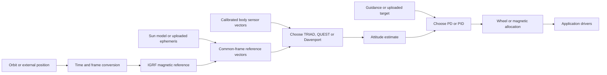

# TinyNadir

TinyNadir is a collection of **68 independently selectable C99 libraries** for CubeSat orbit, environment, attitude, and control calculations. Each module exposes ordinary C functions, uses caller-owned or bounded automatic storage, and performs no heap allocation. Double precision is the main numerical implementation.

**You do not need every module.** A detumbler can use `tinybdot` alone. A spacecraft with an external attitude solution can use guidance and control without TRIAD, QUEST, Sun, or magnetic-field models. An orbit predictor can use SGP4 without any ADCS code. Required mathematical dependencies are linked automatically; the remaining choices belong to the application.

These are building blocks, with explicit supported profiles rather than a translation of every routine or variant in Vallado's repositories. Module READMEs describe inputs, numerical limits, workspace, provenance, and measured comparison errors. Firmware still supplies clocks, mission data, sensor/actuator drivers, scheduling, and fault handling.

## Build only what you use

CMake 3.21+, a C99 compiler with eight-byte IEEE binary64 `double`, and the platform math runtime are required. From the full checkout:

```sh
# All modules, offline regression tests, and runnable examples.
cmake -S . -B build/native -DCMAKE_BUILD_TYPE=Release
cmake --build build/native
ctest --test-dir build/native --output-on-failure

# A small firmware selection, including any required dependencies.
cmake -S . -B build/pointing -DCMAKE_BUILD_TYPE=Release \
  -DTINYNADIR_MODULES='tinypd;tinywheels' \
  -DTINYNADIR_BUILD_TESTS=OFF -DTINYNADIR_BUILD_EXAMPLES=OFF
cmake --build build/pointing
```

Use the same selection when embedding the collection:

```cmake
set(TINYNADIR_MODULES "tinypd;tinywheels" CACHE STRING "Selected algorithms")
add_subdirectory(path/to/tinynadir EXCLUDE_FROM_ALL)
target_link_libraries(app PRIVATE tinypd::tinypd tinywheels::tinywheels)
```

Include headers such as `tinypd/tinypd.h`. Every module has a matching `tinyname::tinyname` CMake target. The original SGP4 API keeps its `tgp4_` function prefix and `tinysgp4/tinysgp4.h` header. Modules can also be configured directly, for example `cmake -S tinyquest -B build/quest`; keep the full checkout because their CMake files share the collection helper and sibling dependencies.

| Collection option | Default | Meaning |
| --- | --- | --- |
| `TINYNADIR_MODULES` | `all` | Semicolon-separated module names; required dependencies are added automatically. |
| `TINYNADIR_BUILD_TESTS` | On for native top-level builds | Build static reference/invariant tests. |
| `TINYNADIR_BUILD_EXAMPLES` | On for native top-level builds | Build examples whose required modules are selected. |
| `TINYNADIR_INSTALL` | On for top-level builds | Install selected libraries, headers, packages, and notices. |
| `TINYNADIR_ENABLE_SANITIZERS` | Off | Native GCC/Clang AddressSanitizer and UBSan. |
| `TINYNADIR_BUILD_TINYNAME` | On | Exclude an optional top-level module from an `all` build; another module may still require it. |

Tests and examples default off for cross-compilation and subproject use. Supply your platform's `CMAKE_TOOLCHAIN_FILE` for firmware; it chooses the CPU, FPU, ABI, linker, and runtime. Per-module test/install options can override collection defaults; SGP4 retains its historical `TGP4_*` options.

## Algorithm glossary

The tables describe functional connections, which need not be link dependencies. A model can consume application-supplied data instead of another TinyNadir module. Follow a module link for the exact API and supported domains.

### Mathematics, time, coordinates, and inputs

| Module | Purpose and supported profile | Inputs → outputs; useful connections |
| --- | --- | --- |
| [tinylinalg](tinylinalg/README.md) | Small vector/matrix operations, LU/linear solves, Cholesky, symmetric eigenpairs; dimensions 1–16. | Arrays and scratch → factors/solutions; shared estimator/allocation mathematics. |
| [tinyrotation](tinyrotation/README.md) | Quaternion, DCM, axis-angle, rotation-vector, ZYX Euler conversions, composition, and SLERP. | Rotation → another representation or rotated vector; establishes attitude conventions. |
| [tinytime](tinytime/README.md) | Gregorian calendar, split Julian dates, UTC/TAI/TT/UT1, approximate geocentric TT→TDB. | Epoch and supplied time offsets → labeled time scales; calendar years 1600–9999, uniform 86400-second days, no `second=60` input. |
| [tinyeop](tinyeop/README.md) | Bounded caller-table interpolation of Earth orientation and optional IAU X/Y/s. | Epoch, table, applicable TAI−UTC → EOP; UT1−TAI interpolation avoids leap discontinuities. |
| [tinyframes](tinyframes/README.md) | Nine Earth-orientation frames, including TEME, GCRF, ITRF, CIRS/TIRS and legacy MOD/TOD/PEF; ERFA IAU-2006/2000A or 2000B. | TT, UT1, EOP and vector/state → transformed coordinates; velocity includes matrix-rate effects. Approximately 1900–2100. |
| [tinygeodesy](tinygeodesy/README.md) | Ellipsoidal geodetic/ECEF conversion and local ENU/NED/SEZ bases. | Position and explicit ellipsoid → location/local axes; ellipsoidal height, not geoid height. |
| [tinyelements](tinyelements/README.md) | Cartesian/classical/prograde modified-equinoctial conversion; RSW, NTW and perifocal bases. | Osculating state and mu ↔ elements; classical coordinates use semilatus rectum and true anomaly. |
| [tinyanomaly](tinyanomaly/README.md) | Elliptic/hyperbolic Kepler and parabolic Barker equations, anomaly conversion. | Eccentricity/anomaly → anomaly and solve status; mathematical helper, not a state propagator. |
| [tinystumpff](tinystumpff/README.md) | Stable universal-variable Stumpff functions C0–C3. | Scalar argument → four functions; supports Kepler/Lambert. |
| [tinyinterpolation](tinyinterpolation/README.md) | Linear, bounded Lagrange, and cubic Hermite interpolation. | Samples/query → value and supported derivatives; no extrapolation. |
| [tinypolynomial](tinypolynomial/README.md) | Real-coefficient polynomial roots, degrees 1–8, including complex roots. | Coefficients and caller workspace → roots/status; bounded Aberth iteration, not certified root isolation. |
| [tinyelliptic](tinyelliptic/README.md) | Complete/incomplete real Legendre F/E, inverse E, and signed ellipse arc length. | Parameter m=k² in [0,1] and angles → integrals/arcs; distinct from Kepler equations. |
| [tinytle](tinytle/README.md) | Bounded traditional/Alpha-5 TLE parsing, checksums, and decoded-element SGP4 initialization. | Two lines or validated GP elements → elements/satellite; supported ephemeris type 0. |
| [tinyomm](tinyomm/README.md) | SGP4-compatible OMM KVN parser and decoded-field adapter. | Bounded KVN/fields → GP elements/satellite; Earth, TEME, UTC, SGP4 metadata checked. JSON/XML/CSV decoding belongs to the application. |

### Orbit propagation and numerical integration

| Module | Purpose and supported profile | Inputs → outputs; alternatives and overlap |
| --- | --- | --- |
| [tinysgp4](tinysgp4/README.md) | Vallado-compatible conventional SGP4 with near-Earth and deep-space branches. | TLE/initialized GP elements and minutes from epoch → TEME position/velocity in km and km/s. Deep-space behavior is included; SGP4-XP is outside this collection. |
| [tinykepler](tinykepler/README.md) | Universal-variable two-body propagation for nonradial elliptic/parabolic/hyperbolic states. | Osculating Cartesian state, mu, elapsed seconds → propagated state; no perturbations. |
| [tinypkepler](tinypkepler/README.md) | Selected Vallado first-order J2 secular-precession profile. | Compatible elliptic mean elements → state; fixed p/e/i, Kepler mean-anomaly rate, no J4 or drag. |
| [tinysecular](tinysecular/README.md) | First-order averaged J2 angular rates and element advancement. | Mean elements and body parameters → rates/elements; selects averaged mean-anomaly correction or the matching `tinypkepler` convention. |
| [tinymeanosculating](tinymeanosculating/README.md) | Central+J2 centered-one-orbit numerical average and bounded local inverse. | Cartesian orbit ↔ explicitly defined mean equinoctial coordinates; e≤0.3, i≤170°. This is its own filter definition, not Brouwer, DSST, or SGP4 mean elements. |
| [tinyrk4](tinyrk4/README.md) | Classical fixed-step fourth-order Runge–Kutta, 1–32 components. | State, derivative callback and one step → advanced state; physics supplied separately. |
| [tinyrkf45](tinyrkf45/README.md) | Adaptive Fehlberg 4(5), 1–32 components, explicit tolerances and attempt/step bounds. | State and derivative callback → integrated state/statistics; alternative to fixed RK4 for nonstiff problems. |
| [tinycowell](tinycowell/README.md) | Cartesian inertial orbit integration using RK4 or RKF45. | State, explicit central mu, optional force callback → state; compose gravity, drag, SRP and third bodies as needed. |

**Kepler is an alternative orbit model to SGP4, with different initial-condition requirements.** A TLE contains mean elements fitted for SGP4. Passing them to a two-body or numerical propagator as osculating elements changes their meaning. Use SGP4 for conventional GP elements, or initialize another model from a state appropriate to that model. The numerical J2 mean conversion above does not make those mean-element theories interchangeable.

### Environment, forces, and visibility

| Module | Purpose and supported profile | Inputs → outputs; useful connections |
| --- | --- | --- |
| [tinysun](tinysun/README.md) | ERFA epv00/VSOP2000 geometric Earth-to-Sun state, approximately 1900–2100. | TDB → BCRS/ICRS-oriented position/velocity; subtract same-frame spacecraft position for direction. Not an apparent ephemeris. |
| [tinymoon](tinymoon/README.md) | ERFA moon98/Meeus geometric lunar state, approximately 1900–2100. | TT → labeled geocentric state; optional third-body/geometry input. |
| [tinyephemeris](tinyephemeris/README.md) | Cubic Hermite interpolation of caller-supplied position/velocity samples. | Table and epoch → celestial state; alternative to analytical Sun/Moon models, with no JPL archive reader. |
| [tinyigrf](tinyigrf/README.md) | IGRF-14 main-field synthesis with the 2025–2030 coefficient profile, degree 1–13. | Supported date/location → magnetic field in Tesla; ECEF/geocentric/WGS-84 interfaces. Feeds vector estimators and magnetic-actuator simulation. |
| [tinygravity](tinygravity/README.md) | Cartesian solid-harmonic gravity, configurable evaluation degree/order 0–32. | Position, body constants and packed coefficients → potential/acceleration; central/zonal/full harmonic choices use the same kernel. |
| [tinythirdbody](tinythirdbody/README.md) | Differential point-mass third-body gravity including indirect origin acceleration. | Spacecraft/body positions and body mu → acceleration; analytical or uploaded ephemerides are interchangeable providers. |
| [tinyexponential](tinyexponential/README.md) | Layered exponential density from an explicit supplied profile. | Altitude and profile → density; inexpensive alternative to empirical atmosphere models. |
| [tinymsis](tinymsis/README.md) | Full selected NRLMSISE-00 GTD7/GTD7D atmosphere with original switches/Ap history, 0–1500 km input profile. | Location, time and activity drivers → densities/temperatures; caller workspace replaces upstream runtime globals. Not MSIS 2.x. |
| [tinydtm](tinydtm/README.md) | Full selected DTM2000 thermosphere formulation and coefficients, 120–1500 km input profile. | Location, time, flux/Kp drivers → density/temperature/composition; alternative to MSIS/exponential, not DTM2012/2020. |
| [tinyspaceweather](tinyspaceweather/README.md) | Linear interpolation of supplied flux/Ap data and standard-node Kp↔Ap conversion. | Bounded table/query → activity inputs; application supplies required averaging windows/history. |
| [tinydrag](tinydrag/README.md) | Cannonball atmospheric drag. | Density, atmosphere-relative velocity, Cd, area/mass → acceleration; density model is a separate choice. |
| [tinysrp](tinysrp/README.md) | Cannonball inverse-square solar radiation pressure. | Sun geometry, pressure, optical/area/mass parameters and illumination → acceleration; choose an eclipse provider separately. |
| [tinyshadow](tinyshadow/README.md) | Apparent angular-disc illumination, cylindrical shadow, ellipsoid segment obstruction and bracketed event bisection. | Same-frame geometry → light fraction/visibility; one bracketed crossing per event solve, no automatic event scan. |

IGRF supplies a magnetic reference, not an orbit or attitude estimate. MSIS, DTM, and exponential atmospheres are alternative density providers. Their implementation-comparison errors are separate from physical model uncertainty. Some environment models have substantial constant tables; link them only when needed.

### Attitude determination and estimation

| Module | Purpose and supported profile | Inputs → outputs; alternatives and overlap |
| --- | --- | --- |
| [tinycalibration](tinycalibration/README.md) | Apply supplied affine bias/scale/cross-axis corrections and sensor-to-body alignment. | Raw vector and calibration → body vector; applies parameters rather than estimating them. |
| [tinytriad](tinytriad/README.md) | Deterministic attitude from two nonparallel vector pairs. | Reference/body directions → DCM/quaternion; first vector has priority. |
| [tinyquest](tinyquest/README.md) | Weighted Wahba solution using QUEST quartic/Newton and quaternion recovery. | 2–64 direction pairs/weights → quaternion/loss; bounded solve with degenerate-geometry checks. |
| [tinydavenport](tinydavenport/README.md) | Weighted Wahba solution through the largest eigenpair of a 4×4 matrix. | 2–64 direction pairs/weights → quaternion/loss; alternative to QUEST/TRIAD. |
| [tinygyro](tinygyro/README.md) | Quaternion derivative and exact held-corrected-body-rate propagation. | Attitude, gyro, bias, elapsed time → predicted attitude; drift remains without external correction. |
| [tinycomplementary](tinycomplementary/README.md) | Nonlinear complementary attitude/bias observer. | Gyro and 0–64 common-reference direction pairs → attitude/bias; first-order normalized Euler update, gyro-only operation supported. |
| [tinymekf](tinymekf/README.md) | Six-error-state multiplicative EKF with gyro bias, Joseph update and covariance reset. | Gyro, one normalized vector update at a time, noise/covariance → attitude/bias/covariance; first-order covariance discretization and explicit correction/gating limits. |

Choose one suitable instantaneous solver or temporal estimator. QUEST and Davenport solve overlapping weighted problems; TRIAD is a smaller two-vector construction. A filter can be initialized by a snapshot solution, but fusing that solution and its originating vectors as independent measurements would double-count information. A single magnetic direction leaves rotation about that direction unobservable. An accelerometer in orbital free fall does not supply a general nadir reference.

### Guidance, control, allocation, and rotational dynamics

| Module | Purpose and supported profile | Inputs → outputs; useful connections |
| --- | --- | --- |
| [tinyguidance](tinyguidance/README.md) | Two-vector, target-line and nadir desired attitudes. | Same-frame geometry/orbit → desired quaternion and supported reference rate; separate from estimating actual attitude. |
| [tinyslew](tinyslew/README.md) | Shortest rest-to-rest attitude slew with triangular/trapezoidal speed. | Initial/target quaternions, rate/acceleration bounds, elapsed time → reference attitude/rate/acceleration; no jerk or exclusion constraints. |
| [tinybdot](tinybdot/README.md) | Filtered B-dot magnetic detumbling. | Consecutive calibrated body magnetic fields → bounded dipole; no orbit, IGRF or attitude solution required. |
| [tinypd](tinypd/README.md) | Quaternion PD with optional torque feedforward. | Desired/current attitude, current-body rate error, gains → requested body torque. |
| [tinypid](tinypid/README.md) | Quaternion PID with bounded integral, per-axis torque limits and conditional anti-windup. | Attitude/rate error and caller state → torque; alternative to PD. |
| [tinymagnetic](tinymagnetic/README.md) | Minimum-norm magnetic torque projection and component dipole clipping. | Requested torque and body field → dipole, achievable torque and residual; no instantaneous field-parallel authority. |
| [tinywheels](tinywheels/README.md) | Reaction-wheel torque allocation for 1–8 wheels. | Body torque, axes and torque/speed/enable limits → rotor torques/residual; pseudoinverse followed by clipping, without redistribution. |
| [tinydesaturation](tinydesaturation/README.md) | Magnetic wheel-momentum unloading toward an optional target. | Wheel momentum and body field → dipole/achievable external torque; application coordinates wheel counter-torque and modes. |
| [tinyrigidbody](tinyrigidbody/README.md) | Euler rigid-body angular acceleration and quaternion kinematics. | Fixed inertia, optional wheel momentum and applied body torque → derivatives; integrate separately. |
| [tinydisturbance](tinydisturbance/README.md) | Gravity-gradient, residual-dipole, lever-arm, drag-plate and SRP-plate torques/forces. | Supplied environment and body geometry → disturbance; optional simulation/analysis input. |

Desired attitude → torque → actuator allocation is one possible chain. Actuator drivers and a mode supervisor remain application responsibilities. Gains, integration steps, sensor availability and actuator limits need mission-specific closed-loop validation.

### Navigation, transfers, uncertainty, and coverage

| Module | Purpose and supported profile | Inputs → outputs; alternatives and overlap |
| --- | --- | --- |
| [tinyobservations](tinyobservations/README.md) | Relative RA/Dec/range/rates, fixed-station azimuth/elevation/range/rates, and coordinate helpers. | Properly framed relative states ↔ geometric observables; no light time/refraction/aberration. |
| [tinygibbs](tinygibbs/README.md) | Gibbs middle velocity estimate. | Three approximately coplanar inertial positions → velocity; small-angle geometry can be ill-conditioned. |
| [tinyherrickgibbs](tinyherrickgibbs/README.md) | Herrick–Gibbs short-arc velocity approximation. | Three positions and time differences → middle velocity; alternative to Gibbs for suitable small arcs. |
| [tinygauss](tinygauss/README.md) | Classical three-angle Gauss initial orbit estimate. | Sight lines, observer positions, times and optional radius hint → middle state/ranges; eighth-degree roots and truncated f/g. |
| [tinylaplace](tinylaplace/README.md) | Classical Laplace angles-only estimate using LOS curvature. | Direction derivatives and observer kinematics → middle state; convenience three-sample helper requires equal spacing. |
| [tinydoubler](tinydoubler/README.md) | Double-r two-radius Newton/conic-flight-time solution. | Three sight lines/observers, times and radius seeds → state/ranges; elliptic e<0.95, positive far-ray minor-arc profile. |
| [tinybatchls](tinybatchls/README.md) | Weighted bounded Levenberg–Marquardt differential correction. | Callback, measurements, sigmas and seed → fitted parameters/local covariance; 1–8 parameters, ≤64 scalars. |
| [tinysgp4fit](tinysgp4fit/README.md) | Local SGP4 mean-element fit, with optional B*. | Nearby GP seed and ≤10 TEME Cartesian epochs → fitted elements/local covariance; fixed epoch/metadata, positions or positions+velocities. |
| [tinycovariance](tinycovariance/README.md) | First-order covariance mapping, numerical Jacobians, fixed-frame/orbital-coordinate wrappers. | Covariance and transformation → covariance; dimensions 1–6, explicit singular-coordinate handling. |
| [tinyunscented](tinyunscented/README.md) | Scaled Merwe sigma points and Euclidean nonlinear moment transform. | Mean/covariance and callback → transformed moments; dimensions 1–6, not a complete UKF. |
| [tinylambert](tinylambert/README.md) | Universal-variable zero-revolution two-body boundary-value solve. | Endpoint positions and flight time → departure/arrival velocities; short/long way, no multirevolution or Battin branch. |
| [tinyhohmann](tinyhohmann/README.md) | Hohmann, bielliptic and one-tangent impulsive transfer estimates. | Circular endpoint orbits and selected geometry → burn magnitudes/coast times; no finite-thrust guidance. |
| [tinyplanechange](tinyplanechange/README.md) | Inclination/node/combined impulsive plane changes. | Orbit planes, speed/flight-path angle → intersection geometry and delta-v; unchanged speed magnitude. |
| [tinyhills](tinyhills/README.md) | CW/Hill relative propagation, transition matrix and zero-position rendezvous targeting. | Circular-chief mean motion and small rotating-frame relative state → relative state/required velocity. |
| [tinyrendezvous](tinyrendezvous/README.md) | Circular coplanar phasing, moving-target Kepler/Lambert intercept, ideal Edelbaum estimate. | Orbit/transfer inputs → maneuver/coast estimates; Edelbaum is a quasi-circular low-thrust estimate, not a general steering solver. |
| [tinycoverage](tinycoverage/README.md) | Spherical geodesics, nadir-cone footprints, ENU look angles, ideal repeat tracks and bounded access scanning. | Geometry or margin callback → coverage/access; sampled scanning can miss short or grazing events. |

Initial orbit determination and differential correction are different tasks. A Gauss/Laplace result is an initial estimate that may require more observations and a fit. In the synthetic comparison sample, Gauss differed from generating truth by up to 2.77 km and Laplace by 169 km despite much closer agreement with the equivalent implementations. Those are sample outcomes, not universal bounds.

## How the pieces come together

| Use case | A possible selection | What can be omitted or replaced |
| --- | --- | --- |
| Orbit prediction/ground tracking | `tinytle` → `tinysgp4` → `tinyframes` → `tinygeodesy`/`tinyobservations`, with time/EOP inputs | All attitude and control modules. Use `tinyomm` instead of TLE text if that is the supplied GP format. |
| Minimal magnetic detumbling | Calibration → `tinybdot` → application torquer driver | No propagation, reference magnetic field, quaternion estimate or reaction wheels. |
| Sun/magnetic snapshot attitude | Position provider + time/frames → `tinysun`/`tinyigrf`; calibrated measurements → one of TRIAD/QUEST/Davenport | GNSS/uploaded positions can replace propagation. Uploaded vectors can replace onboard environment models. |
| Gyro-aided attitude | Calibrated gyro/vectors → `tinycomplementary` or `tinymekf`; optional snapshot initialization | Choose the observer suited to the mission; neither needs every instantaneous solver. |
| Wheel pointing | Attitude estimate + `tinyguidance` → optional `tinyslew` → PD/PID → `tinywheels` | A star tracker can replace vector estimation. Add magnetic desaturation only if required. |
| Numerical orbit analysis | `tinycowell` + one integrator + selected force/density/ephemeris providers | Choose one atmosphere, and include each acceleration once. SGP4 is unnecessary for a suitable independently supplied Cartesian state. |
| Closed-loop simulation | Selected environment/actuator models → `tinyrigidbody` + integrator → simulated sensors → estimator/controller | Application owns sensor models and timing; simulated truth must stay distinct from estimator inputs. |
| Orbit fitting/transfer support | Observations → selected initial estimator → `tinybatchls`/propagator → covariance/transfer helpers | Often ground-side work. Use `tinysgp4fit` specifically for conventional GP-element fitting. |

A vector-based attitude path has the following data flow; arrows are not mandatory CMake dependencies:



Runnable examples are [detumble.c](examples/detumble.c), [wheel_pointing.c](examples/wheel_pointing.c), and [snapshot_attitude.c](examples/snapshot_attitude.c). The snapshot example composes OMM/SGP4, time/frames, Sun/IGRF, rotations and TRIAD using illustrative orbit/EOP values and synthetic sensor vectors. It demonstrates conventions and connections, not flight sensor performance. Examples are tested when their selected modules are available.

## Conventions and memory

New state/force interfaces generally use **metres, seconds, radians and SI**, with explicit exceptions: legacy SGP4 outputs are **km/km/s**, propagation time is **minutes**, decoded GP/fitting fields retain **degrees, revolutions/day and B* in inverse Earth radii**, and atmosphere/activity interfaces have their documented native drivers. Convert at the boundary rather than assuming a common unit from a C `double`.

Quaternions are **scalar-first Hamilton, reference-to-body**; DCMs map reference coordinates into body coordinates. Matrices use documented row-major arrays. Coordinate velocity and physical body angular rate have different transformation rules. All vector comparisons need consistent frames and epochs. Prograde equinoctial representations retain their retrograde singularity; classical elements retain circular/equatorial ambiguities.

There is no hidden EOP, leap-second, space-weather, gravity-field archive, network, or clock service. Supply applicable data and respect each model's date range. A zero EOP correction is an explicit approximation. Uniform-day calendar handling requires a separate application adapter for an actual UTC leap-second instant.

Heap use is zero in the library code. Working storage is caller-owned state/workspace plus bounded stack; coefficients are read-only. Work limits are explicit for iterative solvers, integrations and searches. Application callbacks, platform math functions, stacks, drivers and other firmware have their own resource costs.

| Example resource | Storage, excluding additional stack/runtime |
| --- | --- |
| SGP4 satellite | 1,560 bytes measured on a 32-bit ABI; 1,568 on the tested 64-bit ABI |
| SGP4 library code/read-only data | 17,024 bytes in the documented Arm GCC 16.2 `-O2` measurement; excludes linked math/runtime |
| QUEST / Davenport workspace | 384 / 544 bytes with eight-byte doubles |
| MEKF state + workspace | 344 + 1,800 bytes |
| Wheel allocator workspace | 312 bytes |
| IGRF coefficient profile | 3,360 bytes read-only; two 14×14 double work arrays add 3,136 bytes of stack before other locals |
| NRLMSISE-00 / DTM2000 workspace | 632 / 1,104 bytes on the tested ABI, plus model constants/stack |
| Numerical J2 mean conversion workspace | 384 bytes; integration time can be substantial |
| Generic batch least squares workspace | 7,360 bytes |
| SGP4 fitting workspace | 10,000 bytes on the tested ABI, including its least-squares scratch and satellite |

Workspace figures are not total RAM budgets. Shared/transitive calls and libm add stack; ABI and optimization change size. Degree truncation in the current IGRF profile reduces work but keeps its compiled coefficient table. Full frame/ephemeris/atmosphere models can consume much more flash than the smallest controllers. Measure the actual linked selection, peak stack, and execution time on the target.

The [SGP4 fixed-point investigation](tinysgp4/README.md#fixed-point-investigation) records why the evaluated 64-bit Q19.44 backend was dropped: coefficient loss and error growth made it unsuitable. That result concerns the tested design; the maintained implementation uses binary64 rather than fixed point or a float backend.

## Validation and provenance

Every module includes committed static reference inputs/outputs plus relevant invariant, singularity, bounded-failure and output/state-preservation tests. Ordinary builds/tests are offline and require no Python, Java, reference checkout, or external algorithm library. Test data are linked into test executables, not firmware libraries.

During development the modules were compared with existing implementations or independent numerical equivalents. Oracle source/packages, generators and raw comparisons are kept under **`.validation/`**, which is excluded from git. Each module's README/NOTICE records its exact source/model, reference version, sampled errors and tolerances. The numerical expectations remain under its `tests/` directory for later changes.

| Reference family | Use in validation |
| --- | --- |
| [CelesTrak/fundamentals-of-astrodynamics, `49df0479c950917c0a2c5ac31f2db6477bba57f6`](https://github.com/CelesTrak/fundamentals-of-astrodynamics/tree/49df0479c950917c0a2c5ac31f2db6477bba57f6) | Vallado orbit, transfer, initial-estimation and related equations; read-only Python oracle where applicable. Independently implemented runtime mathematics; no AGPL oracle code linked. |
| Official Vallado C++ and aholinch SGP4 | The existing [SGP4 provenance table](tinysgp4/README.md#compared-implementations-and-data-provenance) records pinned commits and 20,930 captured propagation requests, including expected failures. |
| NumPy 2.5.4, SciPy 1.18.1, mpmath 1.4.1 | Independent matrix/root/quadrature/high-precision references and DOP853 integrations for numerical modules. |
| AHRS 0.4.0, FilterPy 2.0.0, SciPy Rotation | TRIAD/complementary, covariance/filter, Wahba and rotation comparisons; quaternion conventions explicitly adapted. |
| pyerfa 2.0.1.5, ppigrf 2.1.0, Skyfield 1.55, pymap3d 3.2.0, GeographicLib | Frame/ephemeris, magnetic-field, observation and geometry comparisons, with module-specific versions/profile notes. |
| Original NRLMSISE-00 and Orekit DTM2000 | Full selected atmosphere-model output comparisons; immutable coefficients and caller-owned runtime state. |
| python-sgp4 2.27 plus independent SciPy fitting | Expanded GP inputs and local SGP4 fitting, including near-Earth/deep-space holdouts. |

Reference outputs are checked against independent physics/geometry when an oracle appears wrong. Documented upstream discrepancies are retained in ignored evidence rather than frozen as required behavior—for example, some Double-r solutions, observation angles, and one-tangent flight times. Passing comparisons establish agreement for those cases, not a universal error bound, physical forecast accuracy, estimator consistency under arbitrary sensors, closed-loop stability, or flight qualification.

For native sanitizer checks:

```sh
cmake -S . -B build/sanitize -DCMAKE_BUILD_TYPE=Debug \
  -DTINYNADIR_ENABLE_SANITIZERS=ON
cmake --build build/sanitize
ctest --test-dir build/sanitize --output-on-failure
```

## Installation and licenses

```sh
cmake --install build/native --prefix /path/to/prefix
```

Installed modules provide their own packages. For example, use `find_package(tinyquest CONFIG REQUIRED)` and link `tinyquest::tinyquest`, with `CMAKE_PREFIX_PATH` set to the installation prefix. Required module packages are found transitively. There is no monolithic `find_package(tinynadir)` package.

TinyNadir's original contributions use the [MIT license](LICENSE). Included third-party material retains its terms: ERFA subsets in frames/Sun/Moon use the preserved BSD-style license; DTM2000 includes Apache-2.0 source/data and notices; NRLMSISE-00 retains its public-domain provenance; IGRF coefficients retain IAGA's CC BY 4.0 attribution. Read the selected modules' LICENSE/NOTICE files and installed attribution. Commercial use must respect all applicable notices and terms.
