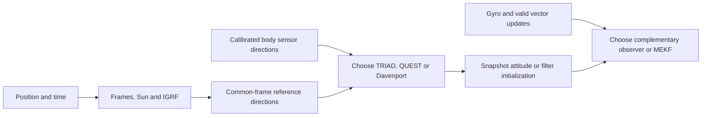

# Attitude

[TinyNadir](../README.md) / Attitude

Turn calibrated measurements into spacecraft orientation. Choose an instantaneous two-/multi-vector solution or a temporal observer/filter. Orbit and environment models can supply reference vectors, but the estimator APIs accept application-supplied vectors.

## Choose an estimator

| Need | Selection |
| --- | --- |
| Two valid vector pairs, with one preferred direction | `tinytriad` |
| Weighted solution from multiple directions | `tinyquest` or `tinydavenport` |
| Propagation between external attitude fixes | `tinygyro` |
| Temporal attitude/bias correction without covariance | `tinycomplementary` |
| Attitude/bias estimate with covariance and gated vector updates | `tinymekf` |

Apply supplied sensor calibration/alignment first. Reference vectors may come from [Sun/IGRF models](../environment/README.md), uploaded data or another source. Express reference vectors in one common frame/epoch and measurements in body axes.



TRIAD, QUEST and Davenport are alternatives; their outputs are not successive corrections. A temporal filter can start from a snapshot estimate, but treating that estimate and the same originating vectors as independent measurements double-counts information. One magnetic direction leaves rotation about that direction unobservable; an orbital accelerometer is not a general nadir reference. Gate stale, disturbed, missing and nearly parallel measurements.

The runnable [snapshot example](../examples/snapshot_attitude.c) composes OMM/SGP4, time/frames, Sun/IGRF and TRIAD using illustrative orbit/EOP values and synthetic measurements. A star tracker or other external attitude solution can replace this whole reference-vector chain in a [control](../control/README.md) application.

## Storage and validation

QUEST/Davenport caller workspaces are **384/544 bytes** for binary64. MEKF state/workspace are **344/1,800 bytes**. All require additional bounded stack/runtime; separate workspaces/state are needed for independent instances. MEKF uses its documented first-order covariance discretization; complementary propagation uses normalized Euler, so step/gain choices matter.

Comparisons use AHRS 0.4.0, FilterPy 2.0.0, SciPy Rotation/Kabsch and independent NumPy calculations, with explicit quaternion-convention adaptation. See each module for exact profiles, singularities, static fixtures and sampled differences. Reference agreement is not a sensor-performance or flight-estimation guarantee.

## Algorithm glossary

| Algorithm | Purpose and supported profile | Inputs → outputs; connections |
| --- | --- | --- |
| [tinycalibration](tinycalibration/README.md) | Apply supplied affine bias/scale/cross-axis corrections and sensor-to-body alignment. | Raw vector and calibration → body vector; applies parameters rather than estimating them. |
| [tinytriad](tinytriad/README.md) | Deterministic attitude from two nonparallel vector pairs. | Reference/body directions → DCM/quaternion; first vector has priority. |
| [tinyquest](tinyquest/README.md) | Weighted Wahba solution using QUEST quartic/Newton and quaternion recovery. | 2–64 direction pairs/weights → quaternion/loss; bounded solve with degenerate-geometry checks. |
| [tinydavenport](tinydavenport/README.md) | Weighted Wahba solution through the largest eigenpair of a 4×4 matrix. | 2–64 direction pairs/weights → quaternion/loss; alternative to QUEST/TRIAD. |
| [tinygyro](tinygyro/README.md) | Quaternion derivative and exact held-corrected-body-rate propagation. | Attitude, gyro, bias, elapsed time → predicted attitude; drift remains without external correction. |
| [tinycomplementary](tinycomplementary/README.md) | Nonlinear complementary attitude/bias observer. | Gyro and 0–64 common-reference direction pairs → attitude/bias; first-order normalized Euler update, gyro-only operation supported. |
| [tinymekf](tinymekf/README.md) | Six-error-state multiplicative EKF with gyro bias, Joseph update and covariance reset. | Gyro, one normalized vector update at a time, noise/covariance → attitude/bias/covariance; first-order covariance discretization and explicit correction/gating limits. |

## Build an individual algorithm

From the collection root:

```sh
cmake -S attitude/tinyquest -B build/tinyquest -DCMAKE_BUILD_TYPE=Release
cmake --build build/tinyquest
ctest --test-dir build/tinyquest --output-on-failure
```

Keep the full checkout for shared CMake helpers and dependencies across groups. Link `tinyquest::tinyquest`; public include paths and C API names are unchanged. Building one algorithm includes its required dependencies, not every algorithm in this group. See the [collection build options](../README.md#build-and-test).
